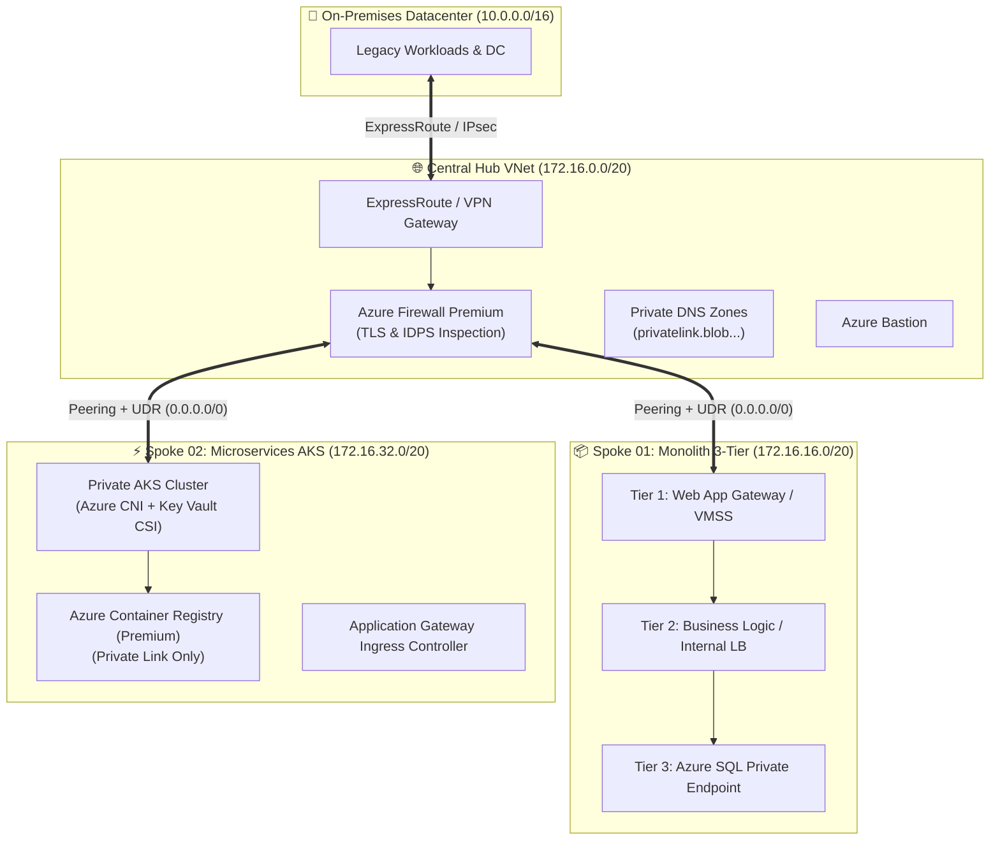

# 🏛️ Enterprise Cloud Architecture & Landing Zone Blueprint

## 1. Overview
This architecture specification implements an enterprise-scale Microsoft Azure Cloud Adoption Framework (CAF) Landing Zone supporting both **Monolithic 3-Tier Enterprise Systems** and **Modern Cloud-Native Microservices (AKS)** under a zero-trust network fabric.

---

## 2. Global Network Topology (Mermaid)

---

## 3. Core Architectural Pillars

### A. Centralized Egress & Inspection
* All spoke subnets have a **User Defined Route (UDR)** sending `0.0.0.0/0` (internet-bound traffic) directly to the private IP of the **Azure Firewall Premium** (`172.16.0.4`).
* No public IP addresses are permitted on individual VMs or Kubernetes worker nodes.

### B. Microservices Isolation (AKS)
* **Private API Server**: The Kubernetes control plane is completely shielded from public internet access.
* **Secret Injection**: Secrets are mounted into pods directly via the **Azure Key Vault Secrets Store CSI Driver** without ever persisting in etcd.
* **Content Trust**: Images must be cryptographically signed before deployment.

### C. Enterprise Monolith Isolation
* **Tier-to-Tier Network Security Groups (NSGs)** prevent direct communication between Web and Database tiers.
* Database accepts connections **strictly** from the Application Subnet CIDR over port 1433 via Private Endpoint.
