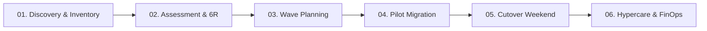

# 🚚 100+ Enterprise Application Mass Cloud Migration Playbook

## 1. Executive Summary
This playbook governs the end-to-end migration of over 100+ enterprise workloads across Dev, UAT, and Production environments from legacy on-premises datacenters to Azure Cloud.

---

## 2. The 6-Phase Migration Lifecycle

### Phase 1: Automated Discovery & Inventory
- Deploy Azure Migrate appliance across VMware / Hyper-V clusters.
- Map cross-server dependencies (Network Connection Tracker).
- Categorize applications by criticality: Tier 1 (Mission Critical), Tier 2 (Core Business), Tier 3 (Internal).

### Phase 2: Assessment & 6R Categorization
- **Rehost**: 40% of standard Windows/Linux VMs migrated via Azure Migrate with zero code changes.
- **Replatform**: 35% of relational SQL instances migrated to Azure SQL Managed Instance / Azure App Service.
- **Refactor**: 15% of business logic decomposed into microservices on AKS.
- **Retire / Repurchase**: 10% of legacy tooling consolidated or replaced with SaaS.

---

## 3. Battle-Tested Checklists

### 📋 Pre-Flight Readiness Checklist (T-minus 30 Days)
- [ ] Non-overlapping CIDR block verification between on-prem and Azure Landing Zones.
- [ ] ExpressRoute circuit health & latency stress testing (< 15ms).
- [ ] Microsoft Entra Connect sync status verified for all service accounts.
- [ ] Target Landing Zone subscriptions, policies, and resource groups provisioned via Terraform.
- [ ] Backup and Disaster Recovery Vault replication initiated.

### 🚀 Cutover Window Protocol (Go-Live Weekend)
- **T-minus 12h**: Final delta data synchronization for databases (Data Migration Assistant / log shipping).
- **T-minus 4h**: Lower public DNS TTL to 60 seconds.
- **T-minus 2h**: Place source on-prem application into read-only maintenance mode.
- **T-minus 0h**: Execute DNS switchover to Azure Front Door / Application Gateway.
- **T-plus 1h**: Run automated synthetic smoke tests across all endpoints.
- **T-plus 2h**: Formal Go/No-Go architecture sign-off meeting.

### 🛡️ Hypercare War Room (T-plus 14 Days)
- 24x7 monitoring on Azure Monitor dashboards.
- Autonomous SRE Incident Triager active for anomaly detection.
- Daily stakeholder KT and operational transition handovers.
